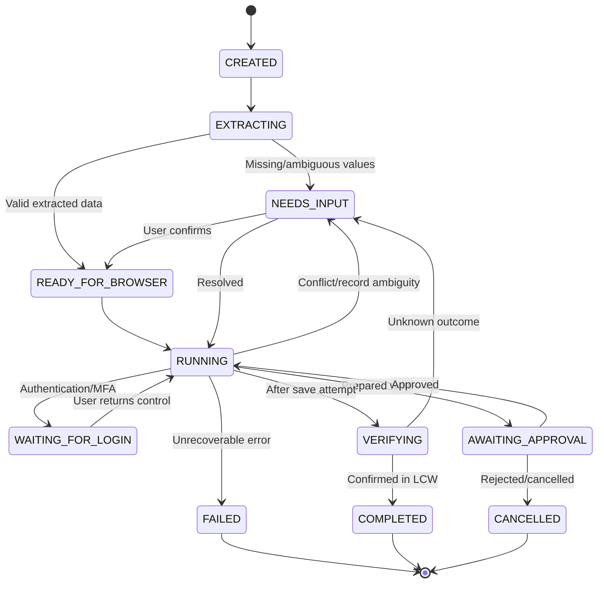

# LCG Command Center — Product Requirements Document (PRD)

**Version:** 0.1 (initial draft)  
**Date:** 2026-10-22  
**Status:** Implementation baseline; subject to LCW access and stakeholder confirmation  
**Primary persona:** School director / authorized admissions operator

## 1. Product summary

**LCG Command Center** is a browser-based application with an **AI Coworker** panel and a **live, controlled LCW browser view**. An authorized user uploads a child-care subsidy contract and requests setup. The agent parses the document, verifies the existing child/family, prepares LCW changes, pauses for sensitive actions and confirms the saved result.

This is a **contract-setup** initial release, not a general-purpose family-enrollment platform. The provided Camila PDF is a one-page non-production training contract; it does not supply all demographic or parent/guardian fields of a new admission application. The initial workflow must not invent those fields.

## 2. Main user experience

Desktop layout (responsive but desktop-first for this prototype):

```text
+--------------------------------------------------------------------------+
| LCG Command Center                         Session • User • Run status    |
+----------------------------------+---------------------------------------+
| AI Coworker / Steps              | Live LCW browser                     |
|                                  |                                       |
| [Upload training contract PDF]   |  User sees actual portal screen       |
|                                  |  Agent interacts with same session    |
| Extracted fields + source        |                                       |
| Contract review / edit           |  [Take control] [Return control]      |
| 1 Extract      ✓                 |                                       |
| 2 Find child   …                 |                                       |
| 3 Contract     —                 |                                       |
| 4 Unit rates   —                 |                                       |
| 5 PRA check    —                 |                                       |
| 6 Verification —                 |                                       |
|                                  |                                       |
| Message / action / approve       |                                       |
+----------------------------------+---------------------------------------+
```

The live browser is a streamed **managed Chromium session**, not an iframe navigating directly to LCW. A secured viewer is proposed for a web deployment. The operator and agent must control **one authoritative browser session** rather than different copies of the website.

## 3. End-to-end user journey

1. Open the Command Center, authenticate as an authorized operator, and create a run.
2. Upload Camila's sample PDF; view file status and validation messages.
3. Receive an extracted field summary (child/family identifiers, center, dates, agency, schedule, tiers, rates, copays and billing settings). Every relevant field shows original value, source and confidence/review status.
4. Correct values through an edit form or chat instruction. For example, an end-date change is displayed as a proposed override and requires confirmation.
5. Start browser execution. Browser opens LCW in an operator-specific session.
6. If sign-in/MFA is required, pause, hand control to the operator and resume only when control returns.
7. Navigate to the correct child/family; compare LCW record identifiers with extracted values.
8. Detect the relevant contract and PRA state; do not create duplicate records. If the uploaded sample requires reusing an existing PRA, use that rule provided the actual LCW dates and details support it.
9. Prepare contract details and unit prices; show a review of values and impact before any save.
10. Obtain explicit human approval, perform the save, then inspect LCW confirmation/record details. If a separate PRA write is genuinely required, perform a separate approval and verification step.
11. Report completed, needs attention or failed state, including LCW-generated identifiers and a sanitized audit trail.

## 4. Functional requirements

| ID | Priority | Requirement | Acceptance criterion |
|---|---|---|---|
| FR-01 | P0 | Upload PDF | Accept PDF, reject invalid/oversized/unsupported input, show upload status. |
| FR-02 | P0 | Extract structured contract | Populate schema from Camila fixture; mark missing fields, no invented values. |
| FR-03 | P0 | Review and edit | Original and effective values visible; user-confirmed changes persisted with reason/source. |
| FR-04 | P0 | Start/pause/resume run | State and current step clearly visible; no duplicate concurrent execution. |
| FR-05 | P0 | Live browser view | Same browser page observed by agent is visible to director. |
| FR-06 | P0 | Human authentication handoff | Pause at sign-in/MFA; no automation of authentication challenge or secret collection. |
| FR-07 | P0 | Verified family/child match | Require matching IDs/center or manual resolution before write. |
| FR-08 | P0 | Contract mapping | Fill known LCW fields, verify field-level values, flag unmapped fields. |
| FR-09 | P0 | Existing PRA awareness | Detect/reuse matching PRA; no blind duplicate creation. |
| FR-10 | P0 | Explicit save approval | Save and any consequential writes blocked until approved by current authorized operator. |
| FR-11 | P0 | Save verification | Check LCW persisted record/confirmation; do not infer success from click. |
| FR-12 | P0 | Failure handling | Clear, bounded retries for safe reads; pause on uncertain write outcome. |
| FR-13 | P1 | AI coworker chat | Accept constrained contract-related commands and report step-level progress. |
| FR-14 | P1 | Source provenance | Show extraction origin, override reason and LCW observed value when available. |
| FR-15 | P1 | Browser takeover | User can take control; automation locks while user is controlling. |
| FR-16 | P1 | Audit history | Store timestamped approvals/actions/results with redacted payloads. |
| FR-17 | P1 | Reopen/resume interrupted run | Recover to a safe checkpoint; reconcile LCW state before retrying writes. |
| FR-18 | P2 | Multi-operator concurrency | Isolated sessions per operator, subject to access and capacity testing. |

P0 = needed for an end-to-end controlled demonstration. The order of delivery follows the five modules, so P0 capabilities can be completed across modules.

## 5. Workflow states



**Invariant:** no write while waiting for human input, user takeover, approval, or unresolved write status. A run can have multiple approval/verification cycles (contract and, if required, PRA).

## 6. Data model: minimum extracted contract fields

- **Identity:** child full name, child ID, family name, family ID, center, LCW agency selection.
- **Authorization:** contract start/end dates, child contract ID, case number, case worker.
- **Schedule:** classroom, program, weekday start/end times, total scheduled hours, tuition.
- **Existing PRA:** current PRA start/end dates and instruction (reuse versus create if justified).
- **Pricing:** part-time/full-time unit tiers, weekly reimbursement rates, copays, maximum and over-market setting.
- **Billing:** reimbursement type, copay type, unit category, variable schedule billing, absence eligibility, restricted hours, absence days at previous provider.
- **Review metadata:** source file ID, extraction status, required-field flag, original/effective values, approved override, LCW observation and last validation.

LCW-generated contract number must be obtained **after** confirmed save; do not fabricate it. The sample's fictional terms must not be treated as official Riverside County rules.

## 7. Contract-specific edge cases

| Case | Required behavior |
|---|---|
| Child name matches but ID differs | Stop: do not pick by name alone. |
| Family ID matches, center differs | Stop for operator review. |
| User changes stop date to 2027-02-10 | Record override; check existing PRA ending 2026-11-20; flag coverage conflict. |
| Existing PRA covers source contract period | Reuse it when LCW details are compatible. |
| PRA absent or does not cover required period | Do not invent an extension/new record; request explicit decision and applicable values. |
| LCW shows already-created contract | Inspect first; require resolution, do not blindly create duplicate. |
| MFA or login expires mid-run | Pause, transfer control, resume from verified state. |
| Save click times out | Query LCW for persisted outcome before considering retry. |
| Source and LCW values conflict | Show both and request confirmation; never silently overwrite. |
| LCW navigation/layout changes | Prefer semantic selectors; fail with actionable evidence if safe mapping impossible. |

## 8. Nonfunctional requirements

- **Security:** authentication and authorization; tenant/operator isolation; allowlisted LCW origin; one writer per browser session; TLS and encrypted secrets; protect child/family information.
- **Privacy:** training data by default; avoid raw PII in console logs, telemetry, screenshots and LLM calls unless approved; configurable retention and deletion.
- **Reliability:** operation checkpoints, safe resume, duplicate prevention, bounded reads/retries and explicit unknown outcomes.
- **Observability:** workflow status, correlated run ID, timings, redacted error categories, opt-in trace capture with restricted access.
- **Performance:** show progress promptly; define quantitative SLAs only after a measured LCW baseline and user volume.
- **Compatibility:** desktop Chrome/Edge target; responsive layout secondary. No promise of identical capabilities on mobile.
- **Compliance:** review LCG/LCW contractual requirements and relevant US child/family data privacy obligations before production; do not assert compliance without review.

## 9. UX acceptance checklist

- [ ] Uploading the Camila training PDF produces a correct, editable review panel.
- [ ] Director sees which values were extracted versus edited.
- [ ] Agent navigates the same LCW instance shown in the interface.
- [ ] Director can safely complete login/MFA.
- [ ] Incorrect identity never leads to a write.
- [ ] Existing PRA is identified and not duplicated.
- [ ] Approval is required before each consequential save.
- [ ] Saved contract is verified and recorded, or the result is visibly unresolved.
- [ ] Browser/site/session errors are recoverable or clearly actionable.
- [ ] End-to-end mock portal test passes before preproduction integration.

## 10. Release and dependency plan

| Module | Product outcome |
|---|---|
| 1. Documentation | Approved story and design baseline. |
| 2. Foundation | Command Center UI, FastAPI health/API, uploads/status; manual environment setup. |
| 3. Intelligence | Extraction, correction, workflow state, review and approval events. |
| 4. Browser | Live browser, authorized LCW interaction, manual takeover and verification. |
| 5. Deployment | Security/test hardening, containerization, Azure deployment and runbook. |

**Not yet verified:** LCW selectors, endpoints, exact login method, ability to read preproduction records, rate rules, and deployment/security approvals. Implementation should use a local mock portal until these are available.

---

**Source basis:** supplied brief, screen-recorded demonstration as described in this project discussion, and the non-production Camila sample subsidy contract. New design requirements above are proposed product decisions.
