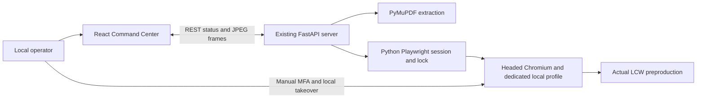
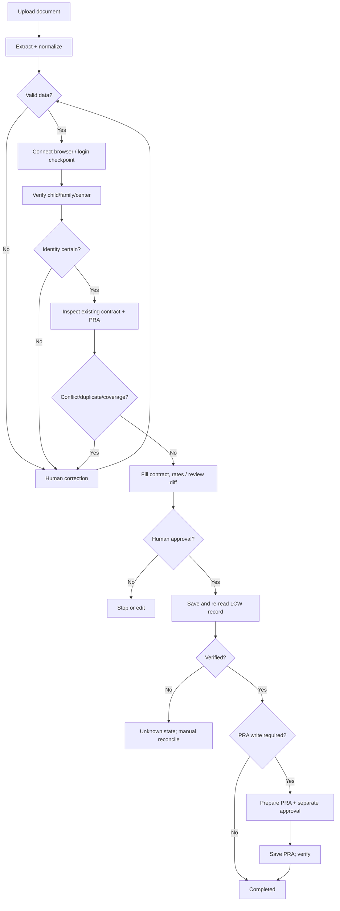

# LCG Command Center — Technical Requirements Document (TRD)

**Version:** 0.3 (owned persistent browser and autonomous read-only inspection)  
**Date:** 2026-10-23  
**Status:** Read-only workflow implemented and offline-tested; real acceptance blocked by unavailable authenticated controlled session  
**Current runtime:** Local React + FastAPI + headed Chromium; Azure is future work

## 1. Engineering decision summary

**Implemented stack:** existing React + TypeScript + Vite frontend; FastAPI + Pydantic backend; PyMuPDF extraction of labeled digital PDFs; Python Playwright with local headed Chromium. A single in-process session and lock are sufficient for the current single-operator read-only scope. Configuration is read from the existing `backend/.env`.

**Deferred options:** LangGraph, Azure OpenAI, PostgreSQL, document storage, Docker/Azure deployment and remote-browser/viewer services. These are not required by this iteration and must not be introduced before reliable local execution. No new dependencies, environment files, agents, services or databases were added; no Git operations were executed.

**Why FastAPI instead of Django?** This project centers on asynchronous I/O, browser actions, real-time events and AI orchestration rather than built-in administrative models. FastAPI has straightforward REST and WebSocket support; Django would be reasonable if built-in admin/ORM were dominant requirements. This is a fit decision, not a claim that Django cannot perform the work.

**Browser display decision:** React displays JPEG frames captured from the exact page Playwright controls. Local native Chromium remains the interaction surface for manual control. In-panel input and hosted browser infrastructure are deferred. A separate LCW iframe or unrelated browser session cannot satisfy the same-session requirement.

**Why hybrid agent, not unconstrained vision clicks?** Contract values, identity matching and saving are high-consequence operations. Use deterministic field mappings, validation and fixed browser tools first; the LLM handles conversational intent and assistance with ambiguous content only, never direct uncontrolled JS or unapproved writes.

## 2. Reference architecture

### Current local implementation



One backend worker, one OS-locked dedicated profile, one exact controlled page. Chromium is a detached local process; Playwright attaches to its existing default persistent context through loopback-only CDP. API shutdown disconnects automation while retaining the browser, and explicit reconnect resolves the recorded process/target without navigating or logging in. This requires no remote-browser service. The existing extraction endpoint processes uploads in memory; no database or workflow runner is involved. Native operator input is outside the API lock, so the application cannot prevent manual LCW edits in that window; implemented agent actions remain read-only after sign-in.

### Future hosted architecture — proposal only

The following topology is retained for later deployment planning. It is not the current implementation or a requirement for local discovery.

```mermaid
flowchart LR
  OP[Authorized operator] --> UI[React Command Center]
  UI <-->|HTTPS REST + WS events| API[FastAPI API]
  UI <-->|Scoped viewer over WSS| GW[Authenticated browser viewer gateway]
  API --> DB[(PostgreSQL)]
  API --> STORE[(Document / artifact storage)]
  API --> ORCH[LangGraph workflow runner]
  ORCH --> PARSER[PyMuPDF + Pydantic validators]
  ORCH --> LLM[Azure OpenAI (approved inputs only)]
  ORCH --> BA[Playwright browser adapter]
  BA --> CHR[Single isolated Chromium session]
  GW --> CHR
  CHR --> LCW[LCW website — authorized environment]
```

**Single session invariant:** viewer and Playwright must target the same browser desktop/profile. Agent actions and direct human control are mutually exclusive and governed by a server-side lease/lock. An image of a separate browser is not a valid solution.

### Current preview and future takeover

The browser workspace fetches a `page.screenshot(type='jpeg')` frame approximately every 1.5 seconds while visible. Frames are returned with `Cache-Control: no-store` and are not written to disk. Microsoft sign-in and unrecognized pages suppress the preview. This is a low-frame-rate page preview; it does not include browser chrome or accept React mouse/key input. Post-MFA preview integration has not been verified.

**Take control locally** sets human ownership under the shared lock and brings the controlled page forward. Sign-in automation refuses to act while human ownership is active. **Return control** re-observes the page; MFA forces human ownership again. Takeover requests do not wait for the full background inspection: an epoch/event pauses at the next bounded operation, with a 12-second operation limit. Return Control rechecks authentication and restarts from identity search. Stop Inspection cancels automation and retains the PDF/browser. Authenticated real end-to-end takeover remains pending; interruption/resume/cancel is tested offline.

For future in-panel interaction, investigate Chromium CDP `Page.startScreencast`, frame acknowledgments and validated mouse/key events targeting the same page. Add a server-held human-control lease, coordinate scaling, session binding and re-observation before agent dispatch resumes. Do not expose debugging ports or arbitrary CDP commands. This is an investigation, not implemented functionality.

### Remote viewer option — deferred

- On a Linux worker start virtual display (Xvfb), Chromium in headed mode, a protected VNC service and WebSocket gateway (e.g. websockify + noVNC). Playwright controls the Chromium instance on that display.
- Serve the VNC viewer behind authenticated, run-scoped, short-lived access. VNC service and debugging ports must **not** be publicly exposed.
- On **Take control**, suspend agent action dispatch, grant viewer write permission to the authenticated operator and show ownership; on **Return control**, regain lock and re-observe LCW state before continuing.
- POC: one active operator/browser at a time is acceptable only if explicitly labeled. Multi-user version: one isolated browser session per operator/run plus session routing and resource limits.
- Validate browser viewer with a real interactive prototype early in Module 4; this is an integration risk, not a proven feature yet.

## 3. Current repository structure

```text
LCG/
  docs/
    PRD.md
    BRD.md
    TRD.md
    LCW_BROWSER_DISCOVERY.md
  frontend/
    src/
      App.tsx
      BrowserWorkspace.tsx
      App.css
      index.css
      main.tsx
  backend/
    app/
      main.py
      contracts.py
      browser.py
      inspection.py
    tests/
      test_health.py
      test_contracts.py
      test_browser.py
    requirements.txt
    .env                      # Existing operator-managed configuration; ignored
    .lcw-browser-profile/     # Created on first dedicated-profile launch; ignored
  .gitignore
```

Only essential browser implementation, UI, tests and discovery documentation were added to the existing app. The profile directory is runtime data, not source code. There is no mock LCW application or new infrastructure layer.

## 4. Implementation modules and exit criteria

### Module 1 — Research and documentation

- Create `docs/PRD.md`, `docs/BRD.md`, `docs/TRD.md`.
- Capture user workflow and demo/PDF differences; choose baseline stack; document Azure topology, risk and required permissions.
- **Exit:** internally consistent docs and explicit unresolved decisions; no application setup needed.

### Module 2 — Existing local foundation

- React, FastAPI, the virtual environment, dependencies, Chromium and `backend/.env` already existed when browser work began; reuse them.
- Health and PDF extraction routes plus the split-pane UI are present. Run creation and event streaming remain future features.
- **Current boundary:** do not install dependencies, create environment files or execute Git operations.

### Module 3 — Parsing, controlled chat and workflow

- Extract digital PDF text with PyMuPDF. If scanned input is needed later, evaluate OCR/document intelligence; do not guess OCR output.
- **Implemented:** deterministic labeled-contract extraction with source/normalized values, missing/review statuses, upload validation and read-only React review. The original Camila PDF was not available for a fresh extraction check during this browser iteration.
- Define typed `ContractData`, `Provenance`, `Override`, `PRAData` schemas, required/optional fields and validation (dates, weekly hours, currencies, IDs).
- **Future work:** evaluate workflow orchestration, persisted checkpoints, manual corrections, structured chat commands and approval handling when required by the next iteration.
- **Future exit:** validated source extraction, date-override audit trail, missing/contradictory input pauses and offline workflow checks. No additional mock portal or service is required by the current scope.

### Module 4 — Current browser foundation and future workflow

- **Implemented:** a process-owned local Chromium/profile, serialized/idempotent lifecycle, explicit authentication only, same-page preview, background inspection, ID-based child verification, contract/PRA list parsing, field comparison, takeover/resume/cancel and UI reconnection. Pure parsing/comparison lives in `inspection.py`.
- **Verified interactively on real preproduction:** headed launch, login with manual MFA, home/search navigation, child/family/center identity, existing assignment/PRA row and contract list. No record writes.
- **Pending:** authenticated preview/takeover integration and authenticated reuse after restart. Further MFA testing was declined by the operator; do not launch extra test browsers.
- **Read-only workflow:** server-retained extraction ID → existing authenticated session → observed alphabetic search → child/family/center verification → existing assignment and contract lists → deterministic comparison. Synthetic PDF-to-result orchestration is tested; real Camila acceptance is pending. Field entry, approvals and saves remain future work; no add/edit/copy/save action is permitted.
- **Exit for current scope:** document actual observations and boundaries; pass offline checks. This does not imply the full contract workflow has passed.

### Module 5 — Security, testing and Azure

- Add unit/integration/E2E tests, accessibility smoke checks, synthetic fixtures, sanitized logs, trace handling, retention controls and runbook.
- Build and pin Docker images; deploy front-end/API/browser worker(s) to Azure; set up managed identity/Key Vault/PostgreSQL/storage/monitoring as needed.
- Test authentication, web sockets/viewer, browser worker lifecycle, approval gates and failure handling in target environment.
- **Exit:** deployable and tested cloud solution; access-dependent LCW limitations clearly documented.

Current constraints: keep the implementation minimal; reuse the existing app; no dependency installation, new environment files, Git operations, additional agents, databases or infrastructure. Cloud work is deferred.

## 5. Browser-agent tool contract

### Implemented session behavior

- Read `LCW_URL`, `LCW_USERNAME`, `LCW_PASSWORD` from existing `backend/.env`; never hardcode or log credentials. The URL must be HTTPS without embedded credentials, query or fragment.
- Launch the Playwright-installed Chromium executable headed, with fixed `--user-data-dir=backend/.lcw-browser-profile/`, as a detached local process; connect via `chromium.connect_over_cdp` to its private loopback endpoint. This preserves the open browser through API shutdown. Use one existing default context, never `new_context` or a temporary profile. An OS advisory owner lock prevents multiple backends from claiming it; Chromium profile locks are respected. Private process/target metadata stays inside the ignored, owner-only profile.
- Reuse the active context/page without navigating away on repeated starts. Reopen the same profile after a graceful close/restart. If another process owns the profile, report failure; do not silently create a fresh profile.
- Initial dedicated-profile sign-in may still be required. Existing session cookies and Microsoft/LCW policy determine later authentication. Closing the browser retains its profile; it does not sign out. Cross-restart authenticated reuse is untested.
- One backend worker without reload. Serialize navigation/start with `asyncio.Lock`; use a separate frame lock for deduplicated same-page captures. Inspection is one server-owned background task with an immutable source snapshot, idempotent request handling and bounded operations. Takeover changes ownership immediately; no next action may dispatch after that boundary. No extra authenticated test sessions or automatic credential retries.
- Login uses observed `#i0116` / `Next`, `#i0118` / `Sign in`, only after an explicit login action; its attempt flag is retained in private process metadata. Status/upload/Inspect/reconnect never submit credentials. The observed `Approve sign in request` heading pauses for the operator. Other prompts, including `Stay signed in?`, remain manual.
- Recognize authenticated LCW using the configured origin plus observed `#userProfileMenu` and navigation link `Family`. Authentication does not verify a child record.
- Navigation errors/timeouts, closed pages, unfamiliar pages and return to Microsoft sign-in are surfaced with fixed messages. No raw exception text, URL queries, cookies, tokens or DOM are returned by the session API. Automated recovery of arbitrary portal/session-expiry screens is not verified.
- Current browser/job states: `idle`, `authenticated`, `awaiting_authentication`, `awaiting_mfa`, `inspecting`, `paused`, `failed`, `cancelled`, `completed`. An inspection may complete with unverified fields; that is not evidence of contract setup or complete compatibility.

### Implemented parsing and comparison boundary

`inspection.py` validates identifiers from the server-retained PDF extraction, parses actual observed link targets/rows and compares normalized source values against portal evidence. It does not hardcode sample record IDs. All existing contracts/assignments are returned; a unique exact source match may be selected, while ambiguous matches remain unverified. Child detail requires child ID, family ID, center and name. Assignment reads recheck child/family context; contract lists require the exact child-specific heading.

Read-only record lists expose contract ID/agency/dates and assignment classroom/dates/displayed rate description. Unit prices/copays, reimbursement settings, program and detailed schedule remain Not verified because no safe read-only detail controls have been observed. Do not infer them from tuition or a rate label. Empty/unreadable rows remain Not verified until an actual empty-state selector is established; never infer absence from another table. Matching/Different/Missing/Not verified results preserve source text/page, observed value/evidence and a null future-approved-change field. PRA coverage is a date comparison, not full reuse authorization.

### Future workflow tools — not implemented

Expose narrow, observable functions when the workflow is implemented:

```text
open_portal(run_id)
observe_page() -> {url, title, semantic_elements, permitted_snapshot}
find_child(child_id, family_id, center) -> verified match or ambiguity
inspect_contract_and_pra(child_id) -> current state
fill_contract(validated_contract_data) -> form-diff / errors
fill_unit_rates(validated_rates) -> form-diff / errors
request_approval(action, diff) -> approval_token or rejection
save_contract(approval_token) -> attempted reference
verify_contract(expected_values) -> confirmed / absent / uncertain
manage_pra(existing_or_approved_new) -> prepared plan / result
pause_for_user(reason); resume_after_reobserve()
```

Tool policies: restrict destination origins; reject agent-originated arbitrary URLs and JS; action-level timeouts; typed inputs/outputs; redact logs; no browser mutation after losing the control lease; no save without valid run-bound approval; never repeat an uncertain save until reading remote state.

## 6. Workflow definition (LangGraph proposal)



**Important:** The sample PDF says reuse a PRA for 2026-08-08 to 2026-11-20; the video includes an example approved contract extension to 2027-02-10. That extension may exceed PRA coverage; do not automatically proceed to a conflicting save. Ask the operator to resolve the business rule and LCW state.

Actual discovery found an existing assignment for that PRA period and an existing matching agency/date contract. Inspect and reconcile them before entering this future write workflow. Any action that may duplicate a PRA or modify saved data requires explicit approval.

LLM responses are **proposals**: schema-validate every value, cross-check against original PDF and portal, and require human review for unsupported claims. Never let the LLM assert a save succeeded without LCW evidence.

## 7. API contract

### Current routes

| Method | Route | Behavior |
|---|---|---|
| GET | `/api/health` | Backend health |
| POST | `/api/contracts/extract` | Guarded local in-memory PDF extraction; 5 MB / 10 page limits; source-aware result and opaque extraction ID |
| POST | `/api/browser/start` | Explicitly open/reuse the owned headed browser; same fixed profile and exact target |
| POST | `/api/browser/reconnect` | Attach to the already owned local process only; never launch/navigate/login |
| POST | `/api/browser/inspect` | Extraction ID + idempotency request ID; require already authenticated session; start/reuse one read-only job |
| GET | `/api/browser/inspection` | Current job, immutable source, observed records and comparison; survives frontend refresh |
| GET | `/api/browser/document` | Latest in-memory extraction for UI restoration |
| POST | `/api/browser/cancel-inspection` | Stop automation while retaining browser/profile/document |
| POST | `/api/browser/login` | Observed credential steps only; pause for manual challenges |
| POST | `/api/browser/take-control` | Set human ownership and focus the controlled page |
| POST | `/api/browser/return-control` | Set agent ownership, then re-observe; MFA retains human ownership |
| POST | `/api/browser/close` | Graceful close; retain local profile |
| GET | `/api/browser/status` | Session state, ownership and origin; no URL query |
| GET | `/api/browser/frame` | Actual controlled-page JPEG; no-store; suppressed during sign-in/unrecognized pages |
| GET | `/api/browser/navigation` | Visible link labels only; no clicks or record verification |

Browser routes and extraction require a loopback client/host, `X-LCG-Local: 1`, and an allowed frontend Origin when supplied (`http://localhost:5173` or `http://127.0.0.1:5173`). This local request guard is not a production operator-authentication system. No generic URL/click/script/input, record-edit, save or CDP routes exist. Raw cookies/tokens/storage and internal process/CDP metadata are never returned. Frames remain in memory, include an actual capture timestamp, and are discarded when navigation changes page/authentication during capture.

### Future versioned workflow API — proposal only

| Method | Route | Purpose |
|---|---|---|
| GET | `/api/v1/health` | readiness / dependency status |
| POST | `/api/v1/documents` | upload PDF, return document ID |
| GET | `/api/v1/documents/{id}/extraction` | structured fields/provenance |
| PATCH | `/api/v1/documents/{id}/fields` | request/confirm validated overrides |
| POST | `/api/v1/runs` | create run for document |
| GET | `/api/v1/runs/{id}` | state, steps, approvals, result |
| POST | `/api/v1/runs/{id}/start` | begin or resume after validation |
| POST | `/api/v1/runs/{id}/chat` | constrained user command |
| POST | `/api/v1/runs/{id}/approvals/{approval_id}` | explicit approve/reject (versioned) |
| POST | `/api/v1/runs/{id}/take-control` | acquire operator browser lease |
| POST | `/api/v1/runs/{id}/return-control` | release control and force re-observation |
| GET | `/api/v1/runs/{id}/viewer-token` | short-lived scoped viewer access |
| WS | `/api/v1/runs/{id}/events` | step updates, failures and prompts |

For the future versioned API, every authenticated route must enforce operator scope; write APIs check CSRF/origin protections as appropriate to the chosen auth model, state version/idempotency key and server-side authorization. Viewer access token must not act as an API bearer credential.

## 8. Storage and consistency

The current app has no database. The latest validated extraction and one job/result are retained in process memory; a UI refresh restores them without restarting execution. A backend restart retains Chromium but loses PDF/job memory; upload and explicitly inspect again after reconnecting. It retains browser authentication data only in the dedicated local profile; uploaded PDFs and preview frames are not saved by the application. Browser profile/cache contents remain sensitive runtime data. The following PostgreSQL entities are future proposals:

- `users` / `operator_roles`: principal identifier, permissions.
- `documents`: upload metadata, blob object reference, classification, retention/deletion status.
- `contract_extractions`: typed document values, source location, parsing status (protected).
- `field_overrides`: original/effective value, operator identity, approval timestamp, reason.
- `runs`: document/user/session IDs, current workflow state, version, timestamps, result.
- `steps`: per-run step state, attempt count, redacted diagnostics.
- `approvals`: action, exact payload hash, operator ID, expiry, decision.
- `browser_sessions`: run-scoped worker/lease mapping, takeover owner, last heartbeat.
- `audit_events`: actor, action, event type, time, correlation ID, sanitized metadata.

Contract data should have encryption-at-rest and application access controls; use opaque references in logs. Files/screenshots/traces may contain sensitive information: restrict, encrypt, minimize, auto-expire. Workflow state must survive an API restart, but a Chromium tab itself is not durable; after a worker crash, reauthenticate if needed and re-observe LCW before any write.

## 9. Future Azure deployment plan — deferred

### Prototype deployment

```text
Azure Static Web Apps or Container Apps static frontend
          │ HTTPS + WSS
Azure Container Apps: FastAPI API / workflow
          │ private network / authorized service access
Azure Container Apps: isolated browser worker + Chromium + viewer gateway
          │
LCW preproduction (only when authorized)
          │
PostgreSQL Flexible Server + Blob Storage
          │
Azure OpenAI / Key Vault / Azure Monitor
```

- Build/push versioned container images to **Azure Container Registry** and use managed identities/Key Vault references for secrets where possible.
- **Frontend:** Azure Static Web Apps is convenient for the React build; alternatively use another Container App to avoid extra hosting model.
- **API:** Azure Container Apps running FastAPI (HTTPS, WebSocket status events, readiness checks).
- **Browser worker:** separate container with Chromium/system dependencies and display stack. Keep worker private; expose viewer through an authenticated gateway only. For a simple demo a single active browser worker is acceptable; concurrency and worker affinity need explicit architecture before scale-out.
- **Database:** Azure Database for PostgreSQL Flexible Server. **Documents:** Blob Storage with private access. **Secrets:** Key Vault. **AI:** approved Azure OpenAI deployment. **Monitoring:** Application Insights / Azure Monitor with PII filtering.
- **Deployment:** Dockerfiles and deployment commands/IaC developed in Module 5, first deployed manually; optional CI/CD after explicit operator choice.
- **Network:** TLS; IP / origin allowlists where available; egress restrictions; confirm LCW portal is reachable from Azure and permits this automation.
- **Sessions:** Container Apps affinity is not a substitute for durable browser-session routing; a replica can disappear. Do not store critical run history in ephemeral container disk.
- **Cost:** no cost estimate until region, CPU/memory, session counts and Azure account pricing are known. Browser workers may require always-on allocation during active sessions.

### Operational risks to test in Azure

1. Chromium launches and the Linux container supports required sandbox/system libraries.
2. Browser stays alive for an operator-controlled login/MFA session, including websocket timeout/reconnection.
3. noVNC viewer only exposes correct operator's session and revokes write access when agent regains control.
4. Session loss reports an explicit interruption; no automatic duplicate contract/PRA submission.
5. Health probes, resource constraints, startup delays, secret access and application logging work in the target tenant.
6. Browser viewer traffic is encrypted and authenticated; VNC and CDP ports remain internal.

## 10. Future workflow testing strategy

| Test layer | Scope |
|---|---|
| Unit | extraction parser, field validators, schema serialization, approval token verification |
| Agent state | LangGraph transitions, interrupt/resume, conflict handling, run version checks |
| Browser integration | observed real LCW selectors, login pause, child ID matching and existing-PRA inspection; write/save checks only in a separately authorized scope |
| Negative tests | wrong child/family, duplicate contract, conflicting dates, altered rates, timeout after save |
| Human takeover | agent stops on takeover; resumes only after release + page observation |
| End-to-end | PDF → verified existing LCW records → approved changes → saved-state verification, only after separate authorization for writes |
| Azure smoke | frontend/API, session stream, preproduction connectivity, restricted secrets/logs |

Store synthetic fixtures in the repository. **Do not commit live auth cookies, LCW credentials, real children's data, trace archives or video recordings with personal information.** The dedicated local profile is sensitive and is already excluded by `.gitignore`; do not commit or share it.

## 11. Local operation and verification policy

Use the existing runtime and dependencies. Do not install packages, create environment files or execute Git operations in this iteration. Start one backend worker without reload:

```bash
.venv/bin/python -m uvicorn backend.app.main:app --host 127.0.0.1 --port 8000 --no-access-log
```

The existing frontend uses `npm run dev` from `frontend/`. Starting the API/UI does not itself open Chromium or trigger sign-in. **Open LCW** uses the dedicated profile when the operator is ready. Do not start additional backends/browsers to validate login. The earlier authenticated temporary discovery context cannot be retroactively converted into the new dedicated profile.

Offline verification commands, from the indicated project directory:

```bash
# Repository root
PYTHONPATH=backend .venv/bin/python -m pytest backend/tests -q

# frontend/
npm run build
npm run lint
```

On 2026-10-23 all **70 backend tests**, TypeScript checks, frontend production build and lint passed. Backend tests use synthetic data/mocked browser objects and do not contact LCW or trigger MFA. They cover extraction/health, route restrictions, no record writes, fixed-profile cold/concurrent starts, cross-owner locking, exact-target CDP reconnect, preserved browser on shutdown, no automatic/repeated login, synthetic PDF-to-comparison orchestration, mismatched/ambiguous identities and records, source immutability, expiry, takeover/resume/cancel, refresh during an active run, sanitized failures and frame capture/deduplication. Existing PyMuPDF SWIG deprecation warnings were emitted.

Historical integrated FastAPI launch/login reached MFA on 2026-10-22. The existing backend reported no controlled browser on 2026-10-23; no new browser, portal navigation, login or MFA was initiated. The new detached-process/CDP lifecycle has only mocked verification so far. Post-MFA preview/takeover and cross-restart authenticated profile reuse remain pending because the operator declined another MFA test. No new login is requested for validation now. The broader testing matrix in section 10 describes later workflow/deployment checks, not completed tests.

## 12. Verified discovery and unresolved decisions

### Actual LCW navigation — 2026-10-22

Target: `https://lcw2-preprod.learningcaregroup.com/center/daycare.do`, read from `backend/.env`. Interactive Python Playwright completed the credential flow, paused for operator-completed MFA, then reached the authenticated portal. In that temporary discovery session, **No** was selected at **Stay signed in?**; the permanent-profile implementation leaves this choice to the operator.

| Screen / step | Observed selector or route | Outcome |
|---|---|---|
| Microsoft username/password | `#i0116`, button `Next`; `#i0118`, button `Sign in` | Credentials submitted from configuration; MFA remained manual |
| LCW home | `/center/daycare.do`, `#userProfileMenu`, navigation link `Family` | Authenticated; selected center 0265-CA Jurupa Ave |
| Family lookup | Search-icon link accessible name `\uf002`, then button `A - B` | Alphabetical family results reached |
| Child result | `a[href="cgchild.do?child_id=1155030"]` | Camila detail opened at `/center/cgchild.do` |
| Identity | Child detail header/admission text | Child ID 1155030; family ID 870985; Family Center 0265-CA Jurupa Ave |
| Existing PRA | Tab `Program/Room Assignment` | Active School Age 2 assignment 08/08/2026–11/20/2026; displayed rate SU County EE School Age-B/A ($170.00) |
| Contract navigation | Tab `Third Party`, `/center/familyThirdParty.do`, observed `javascript:viewContracts(1155030,'Barajas, Camila')` link | Existing third-party contract list read |
| Existing contract | List row; existing `editContract(1833773)` link was observed, not clicked | CA - ST Riverside County Office of Ed; 09/28/2026–10/02/2026; ID 1833773 |

Dynamic `sm-…` menu IDs changed and must not be hardcoded. A CSS text selector for the search icon timed out; its accessible-role selector worked. Clicking the top Search textbox alone did not load results. Text search, Advanced Search, full search-result URL parameters, full PRA details, contract fields, unit prices/copays and save behavior were not tested. No selectors for those untested workflows may be treated as verified.

No LCW record was created, modified, submitted or saved. Child/family/PRA/contract inspection above is historical interactive evidence. The new autonomous application actions use those observed controls but have not been exercised against live LCW. Detailed observations and limitations are in [LCW browser discovery](LCW_BROWSER_DISCOVERY.md).

**Current decisions:** existing React/FastAPI/PyMuPDF, local Python Playwright, one dedicated persistent profile, actual preproduction, read-only agent actions after login, same-page preview and local human control. Extra services, agents, databases and remote-browser infrastructure are deferred.

**Still to validate:**

- Authenticated preview/takeover integration and profile reuse after restart, when the operator is ready; no additional MFA tests now.
- Real Camila PDF → autonomous search/identity → contract/PRA inspection → field comparison → displayed results. This is implemented and tested synthetically but remains the live acceptance blocker.
- Full contract field map, PRA schedule/rate compatibility and reconciliation of existing contract 1833773 before any future write.
- Approval binding, duplicate prevention and saved-state verification in a separately authorized iteration.
- Future operator authentication, profile retention/deletion, tenant isolation and deployment/security requirements.
- Azure region/access, cloud session continuity and viewer performance only when hosted deployment is requested.

**Not acceptable:** invented selectors or tested-workflow claims, bypassed MFA, repeated fresh test browsers, unapproved changes to saved LCW data, duplicate PRA creation or interpreting fictional training rates as official policy.

## 13. Research references (official documentation, accessed 2026-10-22)

- FastAPI WebSockets: https://fastapi.tiangolo.com/advanced/websockets/
- Playwright Python Docker/browser dependencies: https://playwright.dev/python/docs/docker
- Playwright auth-state sensitivity: https://playwright.dev/python/docs/auth
- Playwright persistent context: https://playwright.dev/python/docs/api/class-browsertype#browser-type-launch-persistent-context
- Playwright screenshots: https://playwright.dev/python/docs/api/class-page#page-screenshot
- Playwright CDP sessions: https://playwright.dev/python/docs/api/class-cdpsession
- Microsoft session lifetime: https://learn.microsoft.com/en-us/entra/identity/conditional-access/concept-session-lifetime
- Playwright trace viewer: https://playwright.dev/python/docs/trace-viewer
- noVNC project: https://github.com/novnc/noVNC
- Electron external-content embedding and `WebContentsView` alternative: https://www.electronjs.org/docs/latest/tutorial/web-embeds
- Azure Container Apps versus App Service: https://learn.microsoft.com/en-us/azure/container-apps/compare-options
- Azure Container Apps deployments: https://containerapps.azure.com/docs/containerapps/deploy
- Azure Container Apps session affinity caveat: https://learn.microsoft.com/en-us/azure/container-apps/sticky-sessions
- Azure Container Apps temporary storage: https://learn.microsoft.com/en-us/azure/container-apps/storage-mounts
- Azure Container Apps managed identity: https://learn.microsoft.com/en-us/azure/container-apps/managed-identity
- Azure model data privacy (check deployment-specific terms): https://learn.microsoft.com/en-us/azure/foundry/responsible-ai/openai/data-privacy

---

**Evidence boundary:** historical LCW read-only access, identity and existing-record discovery were verified on 2026-10-22. New autonomous implementation verification on 2026-10-23 is offline only, because no controlled authenticated session was available and new login/MFA is not authorized. Integrated authenticated preview/takeover, cross-restart authentication reuse, full field mapping and writes remain unverified. Original PDF/video facts are carried forward from earlier project context; those original attachments were not freshly inspected in this iteration. No end-to-end contract-creation success is claimed.
