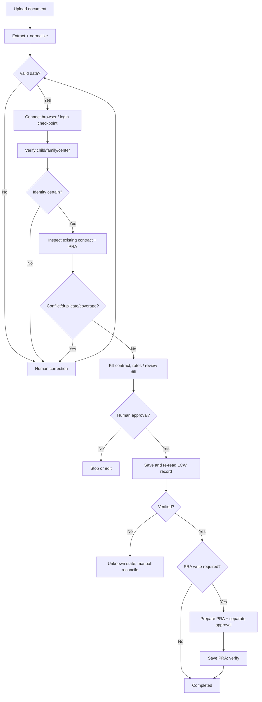

# LCG Command Center — Technical Requirements Document (TRD)

**Version:** 0.1 (initial design)  
**Date:** 2026-10-22  
**Status:** Engineering proposal; critical assumptions marked  
**Deployment target:** Azure (after local and mock-environment validation)

## 1. Engineering decision summary

**Recommended stack:** React + TypeScript + Vite (UI); FastAPI + Pydantic (Python API); Playwright Python (browser adapter); LangGraph (stateful workflow with human interruptions); PyMuPDF (digital PDF text); Azure OpenAI (optional structured extraction assistance and controlled intent parsing); PostgreSQL (durable run/approval state); Chromium in an isolated session; noVNC plus authenticated gateway for displaying the **same** controlled browser in the web application; Docker / Azure Container Apps for cloud hosting.

**Why FastAPI instead of Django?** This project centers on asynchronous I/O, browser actions, real-time events and AI orchestration rather than built-in administrative models. FastAPI has straightforward REST and WebSocket support; Django would be reasonable if built-in admin/ORM were dominant requirements. This is a fit decision, not a claim that Django cannot perform the work.

**Why web first, not Electron?** The brief allows a web or desktop app and asks for Azure deployment. Web + remote controlled Chromium produces a shareable cloud-based Command Center. A normal iframe may be disallowed by LCW and cannot grant arbitrary cross-origin automation. Electron's `WebContentsView` is a viable alternative for a desktop-specific product but creates a separate desktop packaging and Azure-backend deployment architecture; it is not our initial build.

**Why hybrid agent, not unconstrained vision clicks?** Contract values, identity matching and saving are high-consequence operations. Use deterministic field mappings, validation and fixed browser tools first; the LLM handles conversational intent and assistance with ambiguous content only, never direct uncontrolled JS or unapproved writes.

## 2. Reference architecture

```mermaid
flowchart LR
  OP[Authorized operator] --> UI[React Command Center]
  UI <-->|HTTPS REST + WS events| API[FastAPI API]
  UI <-->|Scoped viewer over WSS| GW[Authenticated browser viewer gateway]
  API --> DB[(PostgreSQL)]
  API --> STORE[(Document / artifact storage)]
  API --> ORCH[LangGraph workflow runner]
  ORCH --> PARSER[PyMuPDF + Pydantic validators]
  ORCH --> LLM[Azure OpenAI (approved inputs only)]
  ORCH --> BA[Playwright browser adapter]
  BA --> CHR[Single isolated Chromium session]
  GW --> CHR
  CHR --> LCW[LCW website — authorized environment]
```

**Single session invariant:** viewer and Playwright must target the same browser desktop/profile. Agent actions and direct human control are mutually exclusive and governed by a server-side lease/lock. An image of a separate browser is not a valid solution.

### Browser viewer design (proposed)

- On a Linux worker start virtual display (Xvfb), Chromium in headed mode, a protected VNC service and WebSocket gateway (e.g. websockify + noVNC). Playwright controls the Chromium instance on that display.
- Serve the VNC viewer behind authenticated, run-scoped, short-lived access. VNC service and debugging ports must **not** be publicly exposed.
- On **Take control**, suspend agent action dispatch, grant viewer write permission to the authenticated operator and show ownership; on **Return control**, regain lock and re-observe LCW state before continuing.
- POC: one active operator/browser at a time is acceptable only if explicitly labeled. Multi-user version: one isolated browser session per operator/run plus session routing and resource limits.
- Validate browser viewer with a real interactive prototype early in Module 4; this is an integration risk, not a proven feature yet.

## 3. Proposed repository structure (created manually during Module 2)

```text
LCG/
  docs/
    PRD.md
    BRD.md
    TRD.md
  frontend/
    src/
      components/
      features/{chat,documents,workflow,browser}/
      services/
  backend/
    app/
      api/
      core/
      models/
      schemas/
      services/{documents,workflow,chat}/
      agent/{graph,nodes,policies}/
      browser/{interface,playwright,lcw_adapter}/
      repositories/
    tests/
  mock-lcw/
  infra/
    docker/
    azure/
  .gitignore                  # Manually created in Module 2
  .env.example               # Template created in Module 2; never secrets
  README.md
```

No Git repository, virtual environment, dependencies, `.env` or application code is created in Module 1. The folder above is **planned**, not asserted to exist. The existing local `LCG` folder belongs to the operator.

## 4. Implementation modules and exit criteria

### Module 1 — Research and documentation

- Create `docs/PRD.md`, `docs/BRD.md`, `docs/TRD.md`.
- Capture user workflow and demo/PDF differences; choose baseline stack; document Azure topology, risk and required permissions.
- **Exit:** internally consistent docs and explicit unresolved decisions; no application setup needed.

### Module 2 — Local foundation and Command Center

- Manually create Python 3.11+ virtual environment and Vite React TypeScript project in existing `LCG` directory.
- Manually install pinned Python/npm packages and Chromium browser binaries; manually create `.env` from safe `.env.example` and `.gitignore`.
- Implement FastAPI routes for health, upload metadata, run creation and event streaming; React split-pane shell (AI coworker + browser placeholder).
- Start a small local mock LCW portal for integration tests (may begin with login/child detail stub).
- **Exit:** local frontend and backend run, API health passes, sample file can be uploaded, UI sees backend run status.

### Module 3 — Parsing, controlled chat and workflow

- Extract digital PDF text with PyMuPDF. If scanned input is needed later, evaluate OCR/document intelligence; do not guess OCR output.
- Define typed `ContractData`, `Provenance`, `Override`, `PRAData` schemas, required/optional fields and validation (dates, weekly hours, currencies, IDs).
- Introduce LangGraph workflow with persisted checkpoints, manual corrections, structured chat commands, limited LLM tools and approvals.
- **Exit:** deterministic Camila fixture matches extracted fields; date-override audit trail; missing/contradictory input pauses correctly; mock planner executes without LCW.

### Module 4 — Browser agent and LCW adapter

- Build Playwright browser/session manager with secure configuration; mock LCW pages exercise navigation, identification, fill, review and save.
- Add LCW page-object/adapter mapping using semantic locators and controlled fallbacks. Inspect authorized real LCW screens **only after access is granted**.
- Implement browser viewer and takeover; login/MFA pause; per-action validation; existing-PRA detection; human approval; read-after-write verification; safe recovery.
- **Exit:** end-to-end demo on mock LCW with no duplicate PRA; optionally real authorized preproduction integration if access is available.

### Module 5 — Security, testing and Azure

- Add unit/integration/E2E tests, accessibility smoke checks, synthetic fixtures, sanitized logs, trace handling, retention controls and runbook.
- Build and pin Docker images; deploy front-end/API/browser worker(s) to Azure; set up managed identity/Key Vault/PostgreSQL/storage/monitoring as needed.
- Test authentication, web sockets/viewer, browser worker lifecycle, approval gates and failure handling in target environment.
- **Exit:** deployable and tested cloud solution; access-dependent LCW limitations clearly documented.

After each module: run documented verification commands, review diff, **manually** `git add`, `git commit` and `git push` when the repository/remote has been created by the operator. No automatic GitHub initialization/push.

## 5. Browser-agent tool contract

Expose narrow, observable functions (rather than unrestricted page scripting):

```text
open_portal(run_id)
observe_page() -> {url, title, semantic_elements, permitted_snapshot}
find_child(child_id, family_id, center) -> verified match or ambiguity
inspect_contract_and_pra(child_id) -> current state
fill_contract(validated_contract_data) -> form-diff / errors
fill_unit_rates(validated_rates) -> form-diff / errors
request_approval(action, diff) -> approval_token or rejection
save_contract(approval_token) -> attempted reference
verify_contract(expected_values) -> confirmed / absent / uncertain
manage_pra(existing_or_approved_new) -> prepared plan / result
pause_for_user(reason); resume_after_reobserve()
```

Tool policies: restrict destination origins; reject agent-originated arbitrary URLs and JS; action-level timeouts; typed inputs/outputs; redact logs; no browser mutation after losing the control lease; no save without valid run-bound approval; never repeat an uncertain save until reading remote state.

## 6. Workflow definition (LangGraph proposal)



**Important:** The sample PDF says reuse a PRA for 2026-08-08 to 2026-11-20; the video includes an example approved contract extension to 2027-02-10. That extension may exceed PRA coverage; do not automatically proceed to a conflicting save. Ask the operator to resolve the business rule and LCW state.

LLM responses are **proposals**: schema-validate every value, cross-check against original PDF and portal, and require human review for unsupported claims. Never let the LLM assert a save succeeded without LCW evidence.

## 7. API contract (proposed, not yet implemented)

| Method | Route | Purpose |
|---|---|---|
| GET | `/api/v1/health` | readiness / dependency status |
| POST | `/api/v1/documents` | upload PDF, return document ID |
| GET | `/api/v1/documents/{id}/extraction` | structured fields/provenance |
| PATCH | `/api/v1/documents/{id}/fields` | request/confirm validated overrides |
| POST | `/api/v1/runs` | create run for document |
| GET | `/api/v1/runs/{id}` | state, steps, approvals, result |
| POST | `/api/v1/runs/{id}/start` | begin or resume after validation |
| POST | `/api/v1/runs/{id}/chat` | constrained user command |
| POST | `/api/v1/runs/{id}/approvals/{approval_id}` | explicit approve/reject (versioned) |
| POST | `/api/v1/runs/{id}/take-control` | acquire operator browser lease |
| POST | `/api/v1/runs/{id}/return-control` | release control and force re-observation |
| GET | `/api/v1/runs/{id}/viewer-token` | short-lived scoped viewer access |
| WS | `/api/v1/runs/{id}/events` | step updates, failures and prompts |

Every authenticated route enforces operator scope; write APIs check CSRF/origin protections as appropriate to the chosen auth model, state version/idempotency key and server-side authorization. Viewer access token must not act as an API bearer credential.

## 8. Storage and consistency

Proposed PostgreSQL entities:

- `users` / `operator_roles`: principal identifier, permissions.
- `documents`: upload metadata, blob object reference, classification, retention/deletion status.
- `contract_extractions`: typed document values, source location, parsing status (protected).
- `field_overrides`: original/effective value, operator identity, approval timestamp, reason.
- `runs`: document/user/session IDs, current workflow state, version, timestamps, result.
- `steps`: per-run step state, attempt count, redacted diagnostics.
- `approvals`: action, exact payload hash, operator ID, expiry, decision.
- `browser_sessions`: run-scoped worker/lease mapping, takeover owner, last heartbeat.
- `audit_events`: actor, action, event type, time, correlation ID, sanitized metadata.

Contract data should have encryption-at-rest and application access controls; use opaque references in logs. Files/screenshots/traces may contain sensitive information: restrict, encrypt, minimize, auto-expire. Workflow state must survive an API restart, but a Chromium tab itself is not durable; after a worker crash, reauthenticate if needed and re-observe LCW before any write.

## 9. Azure deployment plan

### Prototype deployment

```text
Azure Static Web Apps or Container Apps static frontend
          │ HTTPS + WSS
Azure Container Apps: FastAPI API / workflow
          │ private network / authorized service access
Azure Container Apps: isolated browser worker + Chromium + viewer gateway
          │
LCW preproduction (only when authorized)
          │
PostgreSQL Flexible Server + Blob Storage
          │
Azure OpenAI / Key Vault / Azure Monitor
```

- Build/push versioned container images to **Azure Container Registry** and use managed identities/Key Vault references for secrets where possible.
- **Frontend:** Azure Static Web Apps is convenient for the React build; alternatively use another Container App to avoid extra hosting model.
- **API:** Azure Container Apps running FastAPI (HTTPS, WebSocket status events, readiness checks).
- **Browser worker:** separate container with Chromium/system dependencies and display stack. Keep worker private; expose viewer through an authenticated gateway only. For a simple demo a single active browser worker is acceptable; concurrency and worker affinity need explicit architecture before scale-out.
- **Database:** Azure Database for PostgreSQL Flexible Server. **Documents:** Blob Storage with private access. **Secrets:** Key Vault. **AI:** approved Azure OpenAI deployment. **Monitoring:** Application Insights / Azure Monitor with PII filtering.
- **Deployment:** Dockerfiles and deployment commands/IaC developed in Module 5, first deployed manually; optional CI/CD after explicit operator choice.
- **Network:** TLS; IP / origin allowlists where available; egress restrictions; confirm LCW portal is reachable from Azure and permits this automation.
- **Sessions:** Container Apps affinity is not a substitute for durable browser-session routing; a replica can disappear. Do not store critical run history in ephemeral container disk.
- **Cost:** no cost estimate until region, CPU/memory, session counts and Azure account pricing are known. Browser workers may require always-on allocation during active sessions.

### Operational risks to test in Azure

1. Chromium launches and the Linux container supports required sandbox/system libraries.
2. Browser stays alive for an operator-controlled login/MFA session, including websocket timeout/reconnection.
3. noVNC viewer only exposes correct operator's session and revokes write access when agent regains control.
4. Session loss reports an explicit interruption; no automatic duplicate contract/PRA submission.
5. Health probes, resource constraints, startup delays, secret access and application logging work in the target tenant.
6. Browser viewer traffic is encrypted and authenticated; VNC and CDP ports remain internal.

## 10. Testing strategy

| Test layer | Scope |
|---|---|
| Unit | extraction parser, field validators, schema serialization, approval token verification |
| Agent state | LangGraph transitions, interrupt/resume, conflict handling, run version checks |
| Browser integration | mock LCW site selectors, login-pause, child ID matching, existing-PRA branch, save verification |
| Negative tests | wrong child/family, duplicate contract, conflicting dates, altered rates, timeout after save |
| Human takeover | agent stops on takeover; resumes only after release + page observation |
| End-to-end | PDF → corrected data → mock LCW → reviewed save → verified confirmation |
| Azure smoke | frontend/API, session stream, preproduction connectivity, restricted secrets/logs |

Store synthetic fixtures in the repository. **Do not commit live auth cookies, LCW credentials, real children's data, trace archives or video recordings with personal information.** Playwright auth storage is sensitive and should be in `.gitignore` if ever used locally.

## 11. Manual local setup policy (Module 2, not executed yet)

When Module 2 starts, the operator will run commands manually from the existing `LCG` directory, including:

```bash
# Preview only — execute manually during Module 2
python3 --version
python3 -m venv .venv
source .venv/bin/activate
python -m pip install --upgrade pip
# Create backend requirements/pyproject and install pinned dependencies after review.
# Create frontend via npm and install dependencies after review.
# Install Playwright Chromium via the documented installer after review.
# Manually create local .env; never put secrets in Git.
```

Likewise, repository creation, remote configuration and each commit/push are operator-driven. Illustrative commands **after** GitHub repository creation:

```bash
# Manually, from LCG/; do not run before inspecting and adding .gitignore
# git init
# git branch -M main
# git remote add origin <your-github-repo-url>
# git add docs/PRD.md docs/BRD.md docs/TRD.md
# git commit -m "docs: define LCG command center requirements and architecture"
# git push -u origin main
```

No commands above have been executed by this document.

## 12. Decisions and discovery checklist

**Chosen for now:** web Command Center; FastAPI; Python Playwright; LangGraph; PostgreSQL; containerized isolated Chromium; Azure Container Apps; human approval for writes; source-preserving extraction.

**To validate before or during Modules 2–4:**

- Exact LCW test URL, environment, automation authorization and account access.
- Screen-by-screen mapping and whether LCW itself creates a PRA or links an existing one.
- Whether contract writes can be staged without saving; source-of-truth for rates and policy.
- Azure tenant access, required deployment region, corporate SSO and retention/security requirements.
- Browser viewer performance/security with noVNC in actual hosting environment.
- Rate and contract date conflicts between video and supplied sample.
- Whether system should persist uploaded training documents beyond a run.

**Not acceptable:** inventing missing LCW endpoints, bypassing MFA, interpreting fictional subsidy terms as real government rules, declaring success without saved-state verification, or silently submitting a duplicate contract/PRA.

## 13. Research references (official documentation, accessed 2026-10-22)

- FastAPI WebSockets: https://fastapi.tiangolo.com/advanced/websockets/
- Playwright Python Docker/browser dependencies: https://playwright.dev/python/docs/docker
- Playwright auth-state sensitivity: https://playwright.dev/python/docs/auth
- Playwright trace viewer: https://playwright.dev/python/docs/trace-viewer
- noVNC project: https://github.com/novnc/noVNC
- Electron external-content embedding and `WebContentsView` alternative: https://www.electronjs.org/docs/latest/tutorial/web-embeds
- Azure Container Apps versus App Service: https://learn.microsoft.com/en-us/azure/container-apps/compare-options
- Azure Container Apps deployments: https://containerapps.azure.com/docs/containerapps/deploy
- Azure Container Apps session affinity caveat: https://learn.microsoft.com/en-us/azure/container-apps/sticky-sessions
- Azure Container Apps temporary storage: https://learn.microsoft.com/en-us/azure/container-apps/storage-mounts
- Azure Container Apps managed identity: https://learn.microsoft.com/en-us/azure/container-apps/managed-identity
- Azure model data privacy (check deployment-specific terms): https://learn.microsoft.com/en-us/azure/foundry/responsible-ai/openai/data-privacy

---

**Evidence boundary:** LCW access has not been provided or tested. Exact target UI behavior remains an implementation-time discovery task; this document specifies a defensible engineering approach rather than pretending it is already verified.
